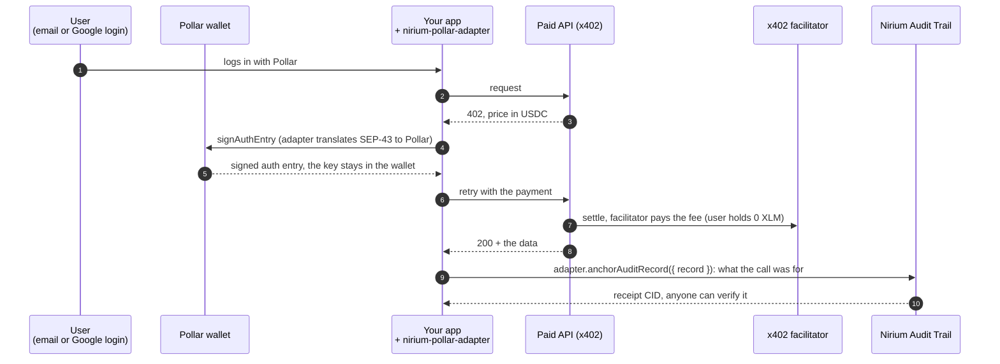

# nirium-pollar-adapter

[](https://github.com/nirium-protocol/nirium-pollar-adapter/actions/workflows/ci.yml)
[](https://github.com/nirium-protocol/nirium-pollar-adapter/actions/workflows/security-gate.yml)
[](https://www.npmjs.com/package/nirium-pollar-adapter)

Nirium adapter for the [Pollar](https://pollar.xyz) SDK. It lets the wallet a user onboarded through Pollar pay for APIs (x402) and anchor tamper-evident records to IPFS, without your app touching keys or learning the x402 protocol.

Two things matter most here: **x402** pays per request, and `anchorOnTransactionSuccess()` (see [API](#api) below) anchors an Audit Trail receipt to IPFS for every Pollar transaction that reaches `success`. The payment itself is already on the ledger; the receipt is worth more when you bind it to your own order or request record (see [`anchorOnTransactionSuccess`](#anchorontransactionsuccesspollarclient-adapter-options) below).

**What a receipt adds over the ledger:** a Stellar payment is already public, so a receipt that only repeats payer, payee and amount proves nothing new; link the transaction instead. Receipts are for what the ledger doesn't hold: policy decisions (including refused payments that were never signed), what a payment was for, off-chain records, and who declared them. More in the [design FAQ](https://github.com/nirium-protocol/nirium/blob/main/docs/DESIGN-FAQ.md).

Both surfaces are **software-only and non-custodial**, and both are **live on Stellar mainnet**: the last x402 payment settled on [24 Nov 2026](https://stellar.expert/explorer/public/tx/786db50b8cba033f56f987adb113e53d2dee7d8a08066ed9e5664fc41f3ec336) (a real USDC transfer on mainnet, our own test made with `nirium`, not with this adapter), and the last Audit Trail anchor is from 24 Nov 2026, both checked on 25 Nov 2026 (UTC) against Horizon and the mainnet agent's `GET /api/reporting/summary?network=mainnet` (`anchors.lastAnchoredAt`).

Wraps [`nirium`](https://github.com/nirium-protocol/nirium), the TypeScript/Python SDK this adapter signs for. See that repo for the full API this exposes through a Pollar wallet instead of a raw keypair.

**Referenced by Pollar.** Pollar's official [x402 payments guide](https://docs.pollar.xyz/docs/guides/x402-payments) uses this adapter and Nirium's endpoints as its "Try it against Nirium" example (checked 14 Nov 2026). That is a documentation reference, not Pollar using Nirium in its own product.

**Try it in a browser:** [nirium-pollar-x402-demo.vercel.app](https://nirium-pollar-x402-demo.vercel.app) (testnet): log in with Pollar, pay 0.05 test USDC, open the receipt at nirium.xyz/verify.

## How it works

The user logs in with email or Google, the Pollar wallet signs, the facilitator pays the network fee, and the app gets a receipt anyone can verify.




## Install

```bash
npm install nirium-pollar-adapter
# optional peer, only for createPollarSigner: @pollar/core >=0.11.4 <0.13.0
```

## Quickstart

```ts
import { PollarClient } from "@pollar/core";
import { createPollarSigner, createNiriumAdapter } from "nirium-pollar-adapter";

const pollar = new PollarClient({ apiKey: "pub_mainnet_…" });
await pollar.login({ provider: "google" });

const nirium = createNiriumAdapter({
  signer: createPollarSigner(pollar),
  network: "stellar:pubnet",
});

// A normal fetch. The 402, the signature and the retry happen underneath.
const res = await nirium.x402Fetch(
  "https://nirium-agent-mainnet.fly.dev/api/v1/premium/market",
);
const data = await res.json();
```

The user pays **$0.05 USDC** and signs nothing else. The x402 facilitator sponsors the network fee, so the wallet does not need XLM for gas.

### Requires @pollar/core 0.11.4+

`createPollarSigner` calls `PollarClient.signAuthEntry`, available from `@pollar/core` 0.11. The peer range is `>=0.11.4 <0.13.0`; CI runs the type check and the full test suite against both ends of it, 0.11.4 and 0.12.0. On older versions it throws an explanatory error, and you can still pass any other SEP-43 signer.

The two sides speak different dialects and the adapter translates between them: x402 expects SEP-43 (`signAuthEntry(xdr, { networkPassphrase, address }) → { signedAuthEntry }`), Pollar expects `signAuthEntry(xdr, { validUntilLedger }) → { status, … }`. The adapter reads the network's latest ledger, sets the expiry, and normalises the outcome. You do not deal with any of it.

```ts
const signer = createPollarSigner(pollar, {
  network: "stellar:pubnet",
  validityLedgers: 120, // ~10 min, the default
});
```

Check at runtime before enabling a pay button:

```ts
import { canSignX402 } from "nirium-pollar-adapter";
<button disabled={!canSignX402(pollar)}>Pay $0.05</button>
```

## Verify it end-to-end today

**Demo app:** the Nirium demo in `pollar-xyz/pollar-apps` had a real `XDR Read Error` on payment. The fix, plus USDC balance, receipt links and clear Pollar error messages, is in [pollar-xyz/pollar-apps#37](https://github.com/pollar-xyz/pollar-apps/pull/37) (open, awaiting Pollar's review; it includes the earlier #36). The live demo already runs that branch: a testnet payment through it settled on 15 Nov 2026 UTC ([`75c8b590…`](https://stellar.expert/explorer/testnet/tx/75c8b590d2ddef1b0d082df43f90cad9ac4d1014678e3d8b34df8dae284c8fb0)) and its receipt verifies at [nirium.xyz/verify](https://nirium.xyz/verify?cid=QmcwsCMfd53mSFAXocRqTXdiJkAkU6DnRf9Dup7pR8Y6EZ). That payment was our own test.

The signer is pluggable, so you can prove the whole path works with a plain Stellar keypair. No Pollar required - this defaults to testnet, no real money moves:

```bash
NIRIUM_DEMO_SECRET=S… node examples/pay-with-keypair.mjs
```

Against mainnet (spends real USDC, $0.05 per call), opt in explicitly:

```bash
NIRIUM_DEMO_SECRET=S… NIRIUM_NETWORK=stellar:pubnet node examples/pay-with-keypair.mjs
```

Verified on mainnet (27 Jul 2026): payment [`25ebaf9a…`](https://stellar.expert/explorer/public/tx/25ebaf9aa7e72c1c3edcc43a1c18aaa102c12eee42c57e02fed4fda79af6605d) settled, evidence anchored at [`QmZiwxidm…`](https://gateway.pinata.cloud/ipfs/QmZiwxidm7pcTqNufxzFyUc7qJrCRN2TKRNwcXkg7vUUwR).

Swapping to a Pollar wallet is one line:

```diff
- const signer = createEd25519Signer(secret, network);
+ const signer = createPollarSigner(pollarClient);
```

**Verified with a real Pollar social login (our own test account, 5 Aug
2026):** a user who signed in with Google paid $0.02 USDC on mainnet
([`e4fa3df9…`](https://stellar.expert/explorer/public/tx/e4fa3df9cb225a4d7f64dd0082eb38218ada4b4af3378f288989a5d4b1116ed9))
while holding **zero XLM** at every point. Pollar sponsors the account reserve
and the trustline. The x402 facilitator sponsors the network fee and is the
transaction source. The user never saw a key, a seed phrase or a gas prompt.

Both proofs above paid `/premium/signals` ($0.02). Since 6-Aug-2026 that
endpoint is **testnet only**: the mainnet agent box runs no autonomous loop,
so a capability guard now returns 501 before any charge. The example above
pays `/premium/market` ($0.05) instead, which has no such guard and still
settles on mainnet today. The two linked transactions remain real; they are
just no longer reproducible word for word with the current example.

## Deferred funding (Pollar "Deferred mode")

If your Pollar app's **Dashboard → Treasury → Funding Mode** is set to
**Deferred**, Pollar does not create the account on-chain at login. Your
backend creates it by calling `POST /v3/wallets/fund`. Checked on testnet on
2026-10-31: for a wallet that did not exist yet (Horizon returned 404), the
call returned 200 with `startingBalance: "0"`, and Horizon then showed the
account with 0 XLM and its reserves sponsored by Pollar. So "funding" here
means creating the account with sponsored reserves, not sending XLM to it.

You often do not need it for x402. A wallet at 0 XLM can sign and settle a
real x402 payment (see the section above: Pollar sponsors the reserve and
the default trustline, and the facilitator sponsors the network fee). Call
`activateWallet()` when your app needs the account to exist on-chain before
that first payment, or to match what Pollar's dashboard considers
"activated."

```ts
import { activateWallet } from "nirium-pollar-adapter";

// Server-side only (Next.js API route, Express handler, webhook). Never
// call this from the browser: it requires the secret key.
const result = await activateWallet(wallet.address, {
  secretKey: process.env.POLLAR_SECRET_KEY!, // sec_testnet_… / sec_mainnet_…
});
// { activated: true, amount: "0" }  - funded now (amount = Pollar's startingBalance)
// { activated: false }                - account already exists on-chain; safe, not an error
```

Calling it twice on an already-funded wallet does not throw. Pollar's own
docs call HTTP 409 "safe to ignore, treat as success," and `activateWallet`
returns `{ activated: false }` rather than raising. Anything else throws
`PollarActivationError` with the real `code` and HTTP `status` Pollar sent,
rather than assuming a fixed meaning per status number. The two Pollar docs
pages that describe this endpoint disagree on what several of the non-200/409
codes mean (402 vs. 403, 503 vs. 502 for what reads like the same failure),
so this adapter passes on what the server actually said instead of picking
one doc to trust.

## API

### `createNiriumAdapter(config)`

| Option | Default | |
|---|---|---|
| `signer` | - | SEP-43 signer. Only `address` and `signAuthEntry` are required |
| `network` | `stellar:testnet` | `stellar:testnet` or `stellar:pubnet` |
| `agentBaseUrl` | box for the network | Nirium agent base URL |
| `rpcUrl` | public RPC for the network | Soroban RPC |
| `fetchImpl` | global `fetch` | for tests or runtimes without global fetch |

Returns:

- **`x402Fetch(url, init?)`**: fetch that pays on `402` and retries. Passes through untouched on `200`.
- **`getPremiumSignals()`**: typed shortcut to the agent's paid signals endpoint. **Testnet only**: signals come from the autonomous loop, which does not run on the mainnet box; there the endpoint returns 501 without charging.
- **`getPremiumMarket()`**: typed shortcut to the agent's paid market-state endpoint ($0.05). Works and charges on **both** networks, with no dependency on the autonomous loop.
- **`anchorAuditRecord({ hash?, record?, txHash?, tag? })`**: anchors evidence to IPFS and returns the CID. No signature, no payment. Anchor **hashes, not personal data**: nobody can guarantee that something is deleted from IPFS, since anyone with the CID may have kept a copy.
- **`getCetesRate()`**: CETES rate as a number, no key required. It is **not a live reading**: today the agent serves a fixed value (5.57, read in June 2026 from app.etherfuse.com/b/cetes).

### `createPollarSigner(pollarClient, opts?)`

Wraps a Pollar client as a SEP-43 `ClientStellarSigner`.

| Option | Default | |
|---|---|---|
| `address` | read from the client's auth state | payer address, if you already have it |
| `network` | `stellar:testnet` | used to read the latest ledger |
| `rpcUrl` | public RPC for the network | Soroban RPC |
| `validityLedgers` | `120` (~10 min) | only used when you hand it an entry directly |

**`signAuthEntry` means two different things, and this is what translates them.**

`stellar-sdk` (`AssembledTransaction.signAuthEntries` → `authorizeEntry`) hands
the signer a **`HashIdPreimage`** (the thing about to be hashed) and expects
the **raw signature** back; it assembles the final entry itself. Pollar's
`POST /tx/sign-auth-entry` expects the full **`SorobanAuthorizationEntry`** and
returns the **signed entry**, because its backend checks the invocation tree
against your app's signing rules before signing, and a hash would tell it
nothing. Both designs are right; they are just not the same one.

Without translation Pollar answers `SOROBAN_AUTH_ENTRY_INVALID - "entryXdr is
not a valid SorobanAuthorizationEntry"`, which reads like a corrupt XDR when the
XDR is fine and simply of another type.

The preimage carries nonce, expiry and invocation. The only extra thing the
entry needs is the signer address, which we have, so the rebuilt entry is exact
and the hash Pollar signs is byte-identical to the one the SDK expects.
The expiry is taken **from the preimage**, never from the clock: it lives inside
the signed hash, so asking Pollar for a different one would yield a signature
that does not validate.

### `activateWallet(publicKey, options)`

Creates a Pollar wallet's account on-chain with sponsored reserves, for apps in Deferred funding mode (`POST /v3/wallets/fund`). **Server-side only.**

| Option | Default | |
|---|---|---|
| `secretKey` | - | `sec_testnet_…` / `sec_mainnet_…`. Never expose this client-side |
| `baseUrl` | `https://server.api.pollar.xyz` | Pollar Server base URL |
| `fetchImpl` | global `fetch` | for tests or runtimes without global fetch |

Returns `{ activated: boolean, amount?: string, queued?: boolean }`. `amount` is the `startingBalance` Pollar reports (`"0"` in the testnet run above). `queued` is `true` on HTTP 202, for co-signed or self-custody wallets, where the user approves the request in their next session. Throws `PollarActivationError` (`.code`, `.status`) for anything other than success (200) or already-funded (409). Also throws a plain `Error` synchronously, before any network call, if `publicKey` is not a valid Stellar `G...` address.

### `anchorOnTransactionSuccess(pollarClient, adapter, options?)`

Anchors an Audit Trail receipt each time a Pollar transaction reaches `success`. It listens to Pollar's `onTransactionStateChange`, which Pollar emits for custodial, external, passkey and co-signed wallets. It is **not** emitted for x402 payments, which this adapter anchors itself. Returns a function that stops listening.

```ts
import { createNiriumAdapter, anchorOnTransactionSuccess } from "nirium-pollar-adapter";

const adapter = createNiriumAdapter({ signer });
const stop = anchorOnTransactionSuccess(pollar, adapter, {
  onError: (err, hash) => console.error("anchor failed", hash, err),
});
```

The receipt carries only `chain`, `network`, `hash` and `observedAt` (no app id), because what goes into IPFS is not deleted. Pollar replays the current state when you subscribe, so the function deduplicates by hash inside the process. It does not deduplicate across restarts: the same hash can be anchored twice. A failed anchor goes to `onError` and never throws into Pollar's listener; the hash can be retried when Pollar sends it again. Options: `chain` (default `"stellar"`), `tag` (default `"pollar-tx"`), `onError`.

**What this receipt adds:** the transaction itself is already on the ledger, so this record only shows that your app observed it, at the time its own clock gave. To make a receipt worth more than the ledger, bind the transaction to something only you hold: call `adapter.anchorAuditRecord()` yourself with the hash of your order or request ID next to `txHash`.

Checked against `@pollar/core` 0.11.4 and 0.12.0 in CI.

**Live check, 2026-11-01, testnet.** `examples/spike-19/anchor-on-success.mjs` logs in to a Pollar testnet app, sends 1 XLM through `pollar.sendPayment`, and anchors the receipt. Transaction [`95717202...b7b`](https://horizon-testnet.stellar.org/transactions/95717202be514ed0ae6d59d88c5950d79ff94b40dad709a430691ad6c4449b7b) (successful, ledger 5506358, 1 payment op) produced Audit Trail receipt [`QmboKKkuwck3zvRx2bqnzUdDFkrEtc1VUHo6rrzm9nyBtD`](https://gateway.pinata.cloud/ipfs/QmboKKkuwck3zvRx2bqnzUdDFkrEtc1VUHo6rrzm9nyBtD). The record holds only `chain`, `network`, `hash` and `observedAt`, and `content_sha256` equals the sha-256 of that record as sent. This is a Nirium self-test on testnet, not third-party use.

### Paying from a browser

Three server-side settings are not optional, and all three fail with messages
that point somewhere else:

| Needed | Otherwise |
|---|---|
| `Access-Control-Expose-Headers: PAYMENT-REQUIRED` | JS cannot read the terms → *"Failed to parse payment requirements"*, which reads as a bad signature |
| `Access-Control-Allow-Headers: PAYMENT-SIGNATURE` | the paid retry never leaves the browser |
| `Access-Control-Allow-Headers: Access-Control-Expose-Headers` | `@x402/fetch` sets that response header **on the request**; without permission the preflight fails |

Client side, `connect-src` must list the resource server, the Soroban RPC and
`sdk.api.pollar.xyz`.

Pollar side (dashboard names as in Pollar's [x402 guide](https://docs.pollar.xyz/docs/guides/x402-payments)):
under **Wallets → Signing rules**, add the USDC SAC with the function `transfer`,
in lowercase (`Transfer` authorizes nothing). Until a contract is listed, every
custodial signing request is rejected. Also enable USDC under **Tokens**, so
wallets get the trustline.

## How this relates to Pollar's `AdapterFn` pattern

Pollar's own adapters (for example the Trustless Work one in its demo) follow the `AdapterFn` pattern from `@pollar/core`: each function returns `{ unsignedTransaction }`, the functions are registered on `PollarProvider` through `adapters={{ ... }}`, and the hook made by `createPollarAdapterHook` signs that transaction with the user's wallet and submits it to the network (`signAndSubmitTx`).

This package does not follow that pattern, on purpose. An x402 payment is not a transaction that gets submitted. The user signs a Soroban authorization entry, it travels to the seller in a header, and the x402 facilitator settles it. If an adapter returned it as `unsignedTransaction`, the hook would submit it to the network by itself. So `createNiriumAdapter` runs the payment itself (it negotiates the 402, signs through `createPollarSigner` and retries), and anchoring is a plain HTTP call.

In practice:

- You use `createNiriumAdapter` directly. It is not registered under `PollarProvider adapters`, and there is no `createPollarAdapterHook` hook for it.
- Nirium operations that do return an unsigned transaction (treasury, payouts) are not exposed here as `AdapterFn`s. They are invite-only on mainnet and outside the scope of this package.
- A registry-pattern version of the payment flow is not shipped. Whether one is possible depends on how an adapter could hand back a signed authorization entry instead of a transaction. That is an open design question, not a plan.

Checked on 2026-10-12 against the published `@pollar/core` 0.11.4 and `@pollar/react` 0.11.4 packages, not their docs. CI runs a contract test against the real `@pollar/core` 0.11.4 and 0.12.0 (`test/pollar-contract.test.mjs` and a compile-time check in `test/pollar-contract.types.ts`), so a change in the shape this package relies on fails the build.

## Scope

| | |
|---|---|
| x402 Settlement | ✅ mainnet |
| Audit Trail (IPFS) | ✅ mainnet |
| Treasury vault (DeFindex, client-owned), Nirium signs and executes | ✅ mainnet, invite-only until a written legal opinion |
| Treasury vault, propose only, you sign | ✅ testnet, open; mainnet, invite-only (`POST /api/treasury/rebalance/propose`, not yet wrapped by this adapter) |
| Nirium's own NiriumVault | audit-gated, testnet only |
| MPP session channels | disabled on both networks (`channel.enabled: false` in `/api/v1/mpp/info`): a channel deposit would be temporary custody, so it waits on the same audit gate |

Nirium never holds customer funds. The user's signature is the authorization; independent partners execute any financial settlement.

## License

Apache-2.0: see [LICENSE](./LICENSE).
